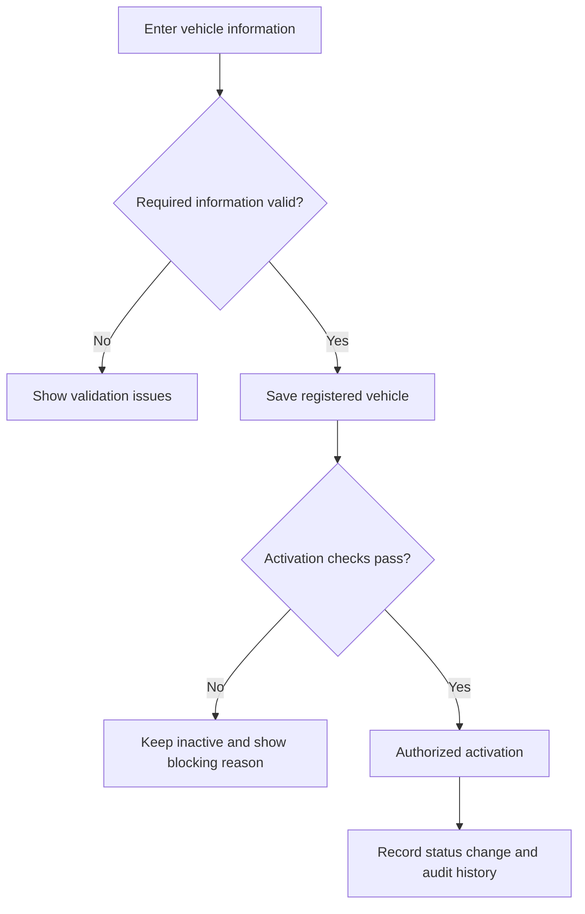
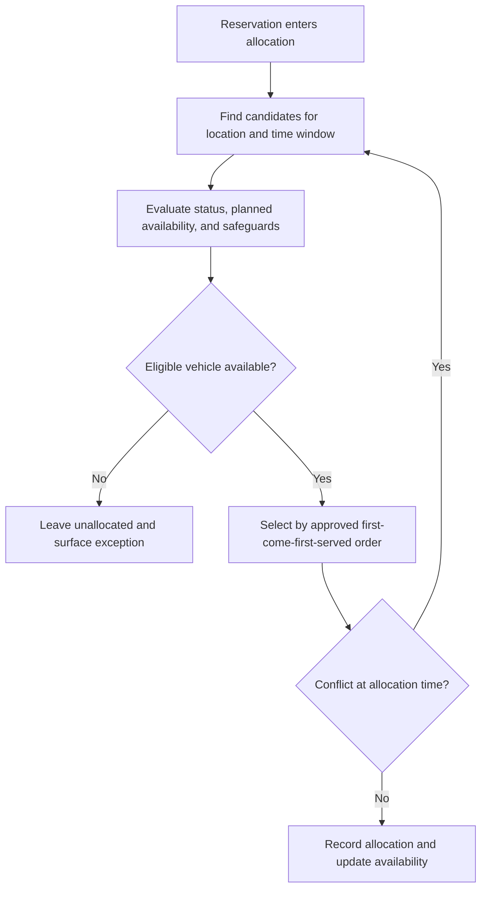
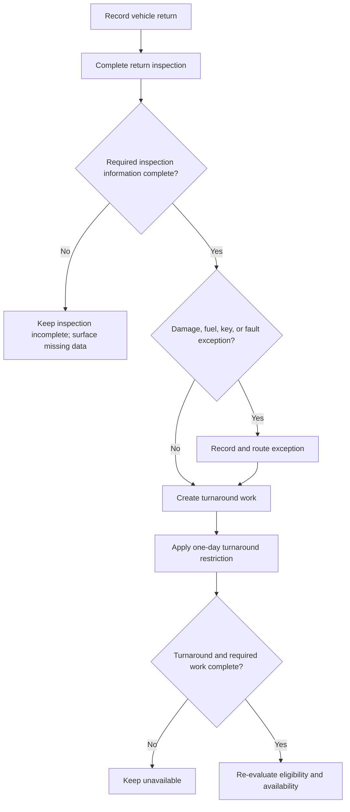
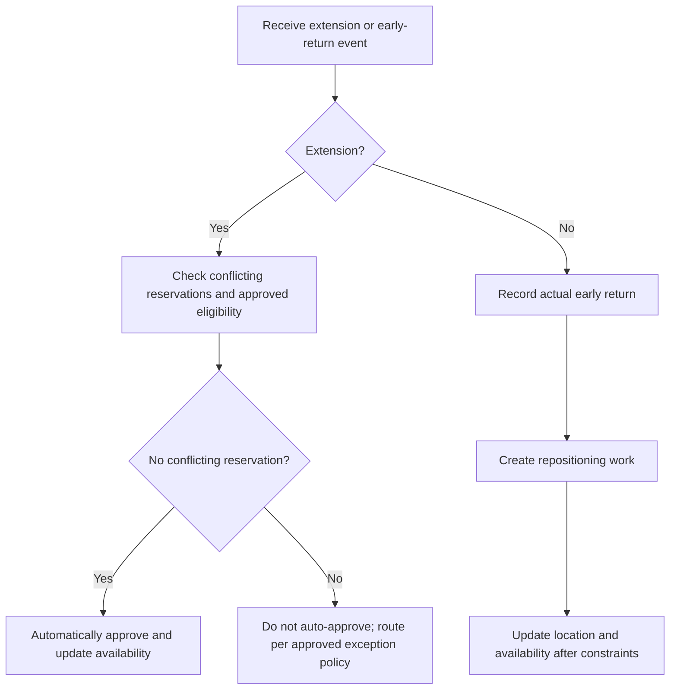

# Car Management Product Requirements Document

## 1. Document Information

| Field | Value |
|---|---|
| Product | Enterprise Car Rental Management Platform — Car Management |
| Document owner | Product Owner (TBD) |
| Author | Product Management (TBD) |
| Version | 0.1 |
| Creation date | 2026-11-01 |
| Last updated | 2026-11-01 |
| Status | Draft for stakeholder review; not stakeholder-validated |

### Source and interpretation

This draft is based on the Car Management issue description. No separate, detailed source requirements document was present in the repository or supplied with the issue. The issue establishes the 17 module names and the explicit rules, thresholds, metrics, and potential dependencies captured below, but does not define detailed field-level requirements, complete workflows, role permissions, or exception policies. Those gaps are identified as open questions rather than treated as approved business rules. Where a workflow is described to make a requirement reviewable, it is a proposed expression of the stated capability and requires confirmation.

## 2. Executive Summary

The Car Management module is the operational system of record for rental vehicles, from onboarding and location assignment through reservation allocation, handover, return, maintenance, and retirement or other disposition (the final lifecycle states require definition). It is intended to give operations teams a centralized view of vehicle identity, location, availability, condition, and work in progress.

The business value is improved fleet visibility and utilization, fewer allocation conflicts, consistent vehicle handovers and inspections, timely maintenance, and auditable operational decisions. The module must preserve the stated safeguards: no double-booking or overbooking, vehicle status updates reflected within five minutes, required handover evidence and identity verification, a one-day turnaround after return, maintenance planning at 10,000–12,000 km intervals, and blocking vehicles whose insurance expires within seven days.

## 3. Product Overview

### Business background

The company is expanding from car sales into rentals. Rental operations require a centralized way to coordinate vehicles across locations and reservations while accounting for vehicle condition, maintenance, handovers, keys, staff tasks, and customer-facing exceptions.

### Product vision

Provide a dependable operational view and workflow for every rental vehicle so authorized staff can make informed, conflict-free decisions throughout its rental lifecycle.

### Product objectives

- Maintain accurate vehicle records, status, location, and transfer history.
- Match eligible vehicles to reservations without double-booking or overbooking.
- Coordinate pickup, delivery, return, inspection, cleaning, and maintenance.
- Make telemetry, alerts, tasks, incidents, and operational reporting visible to the appropriate teams.
- Apply the explicitly stated safety and eligibility safeguards consistently.
- Preserve an auditable record of important vehicle and operational changes.

### Business goals

- Achieve zero double-booking incidents.
- Reflect vehicle status updates within five minutes.
- Record a completed return inspection for every return.
- Block 100% of vehicles whose insurance expires within seven days.
- Reduce the number of vehicles idle for five or more consecutive days.

### Scope

The scope is the 17 functional modules in Section 7 and their supporting data, workflows, reporting, access control, and integrations described in this PRD. Booking, customer, identity verification, GPS, communications, and repair-price capabilities are dependencies where applicable; their ownership and integration boundaries have not been confirmed.

## 4. Problem Statement

Without a centralized vehicle operations capability, staff may rely on disconnected records and manual coordination to determine where a vehicle is, whether it is fit and available, and what work must happen before the next rental. This creates a risk of conflicting reservations, delayed handovers, incomplete inspection evidence, missed service needs, poor visibility into idle inventory, and untracked exceptions such as damage, fuel discrepancies, or lost keys.

A shared system is required to coordinate the vehicle record and its operational events across locations and teams, enforce the stated availability and safety constraints, and provide traceable information for decisions and reporting.

## 5. Stakeholders

| Stakeholder | Interest / contribution |
|---|---|
| Fleet Operations Staff | Maintain vehicle records, locations, status, and operational readiness. |
| Dispatch/Operations Staff | Coordinate allocations, transfers, pickup/delivery, substitutions, and exceptions. |
| Pickup and Delivery Crew | Execute handovers, verify identity, capture evidence, and report condition. |
| Maintenance/Service Crew | Receive and complete service work; record maintenance outcomes. |
| Fleet/Operations Managers | Oversee fleet readiness, risks, utilization, work queues, and performance. |
| Customers | Provide required identity evidence, receive or return vehicles, and report relevant exceptions. |
| Product Owner / Business Owner (TBD) | Confirm business rules, scope, priorities, and unresolved decisions. |
| Technical and QA teams | Design, integrate, implement, and verify approved requirements. |

## 6. User Personas

| Persona | Responsibilities and objectives | System interactions |
|---|---|---|
| Fleet Operations Staff | Keep fleet records accurate and vehicles correctly located and classified. | Onboard and activate vehicles, update status/location, record transfers, and review availability. |
| Dispatcher / Operations Staff | Fulfill reservations and coordinate operational changes without conflicts. | Review eligible inventory, allocate vehicles, arrange transfers, substitutions, extensions, and early-return repositioning. |
| Pickup / Delivery Crew | Complete safe, timely, documented vehicle handovers. | Review assigned tasks, verify customer identity, capture handover proof, and record vehicle condition. |
| Maintenance / Service Crew | Maintain vehicles and return them to operational readiness after work. | Review service schedule and assigned work, record service outcomes, and report faults. |
| Fleet / Operations Manager | Monitor fleet performance and resolve escalations. | View utilization, availability, incidents, alerts, maintenance, and task status; take only approved actions. |
| Customer | Complete rental pickup and return and communicate relevant vehicle issues. | Present driver's license and selfie for verification, receive/return vehicle, and provide required handover or incident information. |

The exact authentication method, role-to-permission matrix, customer access channels, and approval authorities are open decisions (see Sections 12 and 22).

## 7. Functional Requirements

The following requirements cover all 17 named modules. Priority is a proposed planning classification, not a source-approved commitment. Preconditions, workflows, and exception scenarios are stated at the level supported by the issue; details that could change business policy are explicitly left for confirmation.

### FR-CM-001 — Vehicle Onboarding

- **Description:** Allow authorized staff to register a vehicle and maintain the information needed to identify it and determine whether it may enter rental operations. Activation is distinct from registration.
- **Business justification:** Establishes a reliable fleet record and prevents an unreviewed vehicle from being treated as ready for rental.
- **Primary actor:** Fleet Operations Staff.
- **Preconditions:** Staff member has appropriate access; required vehicle information is available (required fields are TBD).
- **Main workflow:** Enter vehicle information → validate required information and uniqueness → save as registered/inactive → complete required readiness checks → activate through an authorized action.
- **Alternate / exception scenarios:** Missing or invalid information; duplicate vehicle identity; incomplete readiness checks; insurance expiry within seven days; attempted activation by unauthorized staff.
- **Business rules:** Do not activate a vehicle with insurance expiring within seven days. The insurance date source, exact comparison boundary, and other activation criteria require confirmation.
- **Priority:** Must Have (proposed).
- **Dependencies:** Vehicle, category, location, insurance data; permissions; potentially reservation and maintenance data.
- **Acceptance criteria:** A valid record can be saved without implying activation. An incomplete or duplicate record is rejected with a useful validation result. Activation is denied when the stated insurance restriction applies.

### FR-CM-002 — Location and Inventory Management

- **Description:** Maintain vehicle home location, current operational location, inventory by location, and vehicle transfer history.
- **Business justification:** Enables accurate location-level availability and coordinated fleet movement.
- **Primary actor:** Fleet Operations Staff; Dispatch/Operations Staff.
- **Preconditions:** Vehicle and location records exist; user is authorized to view or change the relevant inventory.
- **Main workflow:** View location inventory → select a vehicle → record a permitted location change or transfer → retain the transfer history → reflect the updated location in inventory.
- **Alternate / exception scenarios:** Invalid location; conflicting active rental or task; missing transfer information; unauthorized change.
- **Business rules:** Vehicles have home locations and transfer history. Transfer restrictions and required fields are not specified.
- **Priority:** Must Have (proposed).
- **Dependencies:** Vehicle Onboarding, location data, reservation allocation, workforce tasks.
- **Acceptance criteria:** A completed transfer updates the vehicle's current location and preserves its prior transfer history. A transfer with an invalid destination or unauthorized actor is rejected.

### FR-CM-003 — Reservation Allocation

- **Description:** Allocate an eligible vehicle to a reservation using automatic first-come-first-served allocation while preventing double-booking and overbooking.
- **Business justification:** Ensures reservations are fulfilled consistently against actual fleet availability.
- **Primary actor:** Dispatch/Operations Staff; allocation service (automation details TBD).
- **Preconditions:** Reservation and candidate vehicle data are available; the candidate is eligible for the requested period and location.
- **Main workflow:** Receive or identify reservation → evaluate planned availability and restrictions → select the first eligible vehicle under the approved allocation order → record allocation → update availability.
- **Alternate / exception scenarios:** No eligible vehicle; concurrent allocation; conflicting reservation; vehicle is blocked, under maintenance, or otherwise unavailable.
- **Business rules:** Automatic first-come-first-served allocation; no double-booking and no overbooking. Availability must consider real-time status and planned windows.
- **Priority:** Must Have (proposed).
- **Dependencies:** Reservation and booking system, Vehicle Status, Location/Inventory, maintenance, extensions, substitutions.
- **Acceptance criteria:** An eligible vehicle is allocated according to the confirmed first-come-first-served ordering. A conflicting allocation is blocked, including when two requests are processed concurrently. If no eligible vehicle exists, the reservation is not allocated to an unavailable vehicle.

### FR-CM-004 — Vehicle Status and GPS Telemetry

- **Description:** Display and update vehicle operational status and, where telemetry is available, GPS location; identify geofence breaches.
- **Business justification:** Gives operations current vehicle visibility and supports safety and dispatch decisions.
- **Primary actor:** Fleet Operations Staff; Fleet/Operations Managers.
- **Preconditions:** Vehicle exists; status update is authorized or telemetry source is connected.
- **Main workflow:** Receive an authorized status change or telemetry update → associate it with the vehicle and timestamp → display the latest status/location → evaluate configured geofence rules → raise an alert for a detected breach.
- **Alternate / exception scenarios:** Stale, missing, invalid, or out-of-order telemetry; unavailable GPS integration; unauthorized manual status change; unconfigured geofence.
- **Business rules:** Status updates are reflected within five minutes. GPS updates and geofence breach detection are required; update cadence and geofence policy are unspecified.
- **Priority:** Must Have (proposed).
- **Dependencies:** GPS/telematics provider, vehicle record, alerts and notifications.
- **Acceptance criteria:** A valid update is reflected within five minutes of receipt. Invalid telemetry does not silently overwrite a valid location. A breach against an approved geofence rule generates a traceable alert.

### FR-CM-005 — Pickup and Delivery Operations

- **Description:** Coordinate vehicle pickup and delivery operations, including operational tasks, identity verification, and evidence of handover.
- **Business justification:** Supports reliable customer handover and confirms who received the vehicle and when.
- **Primary actor:** Pickup and Delivery Crew; Customer.
- **Preconditions:** Reservation and vehicle allocation exist; vehicle is eligible; task is assigned; pickup/delivery falls within approved operating hours.
- **Main workflow:** Review assigned task → meet customer and vehicle → verify driver's license and selfie → document vehicle handover and capture mandatory proof → complete task and update vehicle status.
- **Alternate / exception scenarios:** Outside 06:00–19:00; identity verification fails or is unavailable; customer absent; vehicle mismatch or condition concern; proof cannot be captured.
- **Business rules:** Pickup and delivery operating hours are 06:00–19:00. Proof-of-handover is mandatory. Driver's license and selfie identity verification are required. Time zone and treatment of an exception are TBD.
- **Priority:** Must Have (proposed).
- **Dependencies:** Reservation, allocation, customer identity verification, task management, notifications.
- **Acceptance criteria:** A normal handover records the reservation, vehicle, participants, time, and required evidence. The handover cannot be marked complete without proof and the required verification result. An out-of-hours operation is handled only under a policy approved by the business.

### FR-CM-006 — Return and Check-In Process

- **Description:** Record a vehicle return, complete a return inspection, capture the vehicle's condition and relevant return details, and initiate turnaround activities.
- **Business justification:** Establishes vehicle condition and readiness between rentals and provides an auditable return record.
- **Primary actor:** Pickup and Delivery Crew; Fleet Operations Staff.
- **Preconditions:** Vehicle has an active rental or an explicitly supported return workflow; authorized staff is performing check-in.
- **Main workflow:** Identify rental and vehicle → record return time and details → complete inspection fields and evidence → record exceptions → set the appropriate follow-up status and initiate cleaning/turnaround.
- **Alternate / exception scenarios:** Missing inspection information; vehicle returned at an unexpected location or time; new damage; fuel or key discrepancy; inspection cannot be completed.
- **Business rules:** Return inspection records are required for every return. A returned vehicle has one day of turnaround before becoming available for another rental. The exact definition of one day and exceptions are TBD.
- **Priority:** Must Have (proposed).
- **Dependencies:** Reservation, inspection, damage, fuel, key, cleaning, status and task modules.
- **Acceptance criteria:** A return is not recorded as inspection-complete until all required inspection information is present. The vehicle cannot be treated as available during its required one-day turnaround. An incomplete inspection is visible as an exception and does not silently satisfy completion.

### FR-CM-007 — Maintenance and Service Scheduling

- **Description:** Track maintenance needs and schedule service based on mileage, faults, or other approved triggers; prevent conflicting use while a vehicle is unavailable for service.
- **Business justification:** Supports safe vehicle operation and reduces missed or overdue maintenance.
- **Primary actor:** Maintenance/Service Crew; Fleet Operations Staff.
- **Preconditions:** Vehicle exists; current mileage and maintenance information are available where needed.
- **Main workflow:** Identify due or required service → create/assign maintenance schedule or task → mark the vehicle unavailable as appropriate → record work and outcome → update maintenance history and readiness.
- **Alternate / exception scenarios:** Mileage is unknown or stale; service conflicts with a reservation; a critical fault is reported; service is delayed or incomplete.
- **Business rules:** Mileage-based maintenance occurs every 10,000–12,000 km. The specific trigger within that range, treatment of time-based service, and return-to-service authority are TBD.
- **Priority:** Must Have (proposed).
- **Dependencies:** Vehicle mileage, workforce tasks, reservations, alerts, repair price list (potential dependency).
- **Acceptance criteria:** Maintenance due within the approved mileage threshold is visible for scheduling. A vehicle identified as unavailable for maintenance cannot be allocated for an overlapping reservation. Incomplete work does not silently mark the vehicle ready.

### FR-CM-008 — Cleaning and Turnaround

- **Description:** Coordinate vehicle cleaning and turnaround tasks after return and before the next rental.
- **Business justification:** Makes preparation work visible and prevents premature reallocation.
- **Primary actor:** Fleet Operations Staff; assigned workforce.
- **Preconditions:** Return has been recorded; vehicle and any next reservation are identifiable.
- **Main workflow:** Create or assign turnaround work after return → record cleaning/readiness outcome → keep the vehicle unavailable for the required turnaround → make it eligible only after required work and timing conditions are met.
- **Alternate / exception scenarios:** Cleaning incomplete; task missed; a next reservation begins before readiness; damage or maintenance is discovered.
- **Business rules:** One-day turnaround after return. Whether this means 24 hours or a calendar day, and the precise required cleaning checklist, are not specified.
- **Priority:** Must Have (proposed).
- **Dependencies:** Return, workforce tasks, maintenance, damage, allocation.
- **Acceptance criteria:** Return triggers visible turnaround work. The vehicle cannot become available before the approved one-day turnaround period and completion conditions. A blocked or incomplete task remains visible to operations.

### FR-CM-009 — Damage and Incident Handling

- **Description:** Record, investigate, and track vehicle damage and operational incidents, including evidence and any chargeable damage determination.
- **Business justification:** Preserves condition history and supports consistent resolution of incidents and customer charges.
- **Primary actor:** Fleet Operations Staff; Pickup and Delivery Crew; Fleet/Operations Managers.
- **Preconditions:** A vehicle and an incident reporter are identifiable; incident recording is authorized.
- **Main workflow:** Record incident → associate vehicle, time, context, and evidence → classify and route for review → document outcome and any approved charge → update vehicle readiness if necessary.
- **Alternate / exception scenarios:** Suspected pre-existing damage; missing evidence; critical fault; disputed responsibility; repair price is unavailable.
- **Business rules:** Return inspection and chargeable damage rules apply. The source does not define damage categories, liability standards, evidence requirements, price values, or approval authority.
- **Priority:** Must Have (proposed).
- **Dependencies:** Inspection, vehicle status, customer/rental record, internal repair price list, alerts.
- **Acceptance criteria:** An incident is traceable to a vehicle and relevant rental/inspection when known. A missing required field or evidence is surfaced as incomplete. A charge is not calculated or applied without an approved damage and pricing policy.

### FR-CM-010 — Fuel Management

- **Description:** Record fuel information at handover and return, compare the two records, and flag discrepancies under the same-to-same policy.
- **Business justification:** Makes fuel condition and exceptions visible throughout a rental.
- **Primary actor:** Pickup and Delivery Crew; Fleet Operations Staff.
- **Preconditions:** Vehicle and rental are identified; applicable handover/return evidence is available.
- **Main workflow:** Record fuel at handover → record fuel at return → compare under the approved same-to-same policy → record or route any discrepancy.
- **Alternate / exception scenarios:** Fuel reading is missing, ambiguous, or inconsistent; customer disputes record; refueling evidence is absent.
- **Business rules:** Fuel follows a same-to-same policy. Fuel measurement format, tolerance, charge calculation, and dispute process are unspecified.
- **Priority:** Should Have (proposed; priority requires approval).
- **Dependencies:** Handover, return inspection, damage/incident handling, notifications, repair/charge policy if applicable.
- **Acceptance criteria:** Handover and return fuel information can be reviewed together. A discrepancy against the approved policy is flagged. Missing data is not treated as a confirmed match.

### FR-CM-011 — Utilization and Analytics

- **Description:** Report fleet utilization, idle time, location-based and global utilization, maintenance status, incidents, and availability.
- **Business justification:** Helps managers balance inventory, identify idle vehicles, and plan operational work.
- **Primary actor:** Fleet/Operations Managers.
- **Preconditions:** Relevant vehicle, reservation, status, location, maintenance, and incident data exist; access is authorized.
- **Main workflow:** Select report or view → apply supported filters and time period → calculate metrics from recorded data → display results with definitions and freshness information.
- **Alternate / exception scenarios:** Incomplete source data; different location time zones; no records for a period; delayed telemetry or status events.
- **Business rules:** Flag a vehicle idle for five consecutive days. Metric definitions and the precise meaning of "idle" require approval.
- **Priority:** Should Have (proposed).
- **Dependencies:** All operational modules and data-quality rules.
- **Acceptance criteria:** Reports distinguish global and location-level utilization and disclose the calculation period. A vehicle reaching five consecutive idle days is flagged according to the approved definition. Missing data is not silently reported as zero.

### FR-CM-012 — Vehicle Swaps and Substitutions

- **Description:** Replace an allocated vehicle when it becomes unavailable, following a defined substitution priority while preserving reservation integrity.
- **Business justification:** Provides a controlled recovery path when the originally allocated vehicle cannot fulfill a reservation.
- **Primary actor:** Dispatch/Operations Staff.
- **Preconditions:** Reservation has an allocation; a substitution need is recorded; replacement candidates are available.
- **Main workflow:** Identify unavailable allocation → find eligible replacements → rank candidates under an approved priority → record replacement and reason → preserve the prior allocation history and notify affected parties as approved.
- **Alternate / exception scenarios:** No eligible replacement; replacement conflicts with another reservation; customer or vehicle category compatibility is uncertain.
- **Business rules:** Vehicle substitution priority exists but its ordering and any customer-consent requirement are unspecified. No double-booking or overbooking remains in effect.
- **Priority:** Should Have (proposed).
- **Dependencies:** Allocation, location inventory, reservation, alerts/notifications.
- **Acceptance criteria:** A replacement is not assigned if it conflicts with another reservation or is otherwise unavailable. The substitution and reason are auditable. Candidate ordering follows only an approved priority policy.

### FR-CM-013 — Extensions and Early Returns

- **Description:** Process rental extension requests and early returns while recalculating availability and coordinating any required vehicle movement.
- **Business justification:** Maintains accurate inventory when rental timing changes.
- **Primary actor:** Dispatch/Operations Staff; Customer.
- **Preconditions:** Existing reservation/rental exists; requested time change is known.
- **Main workflow:** Receive request or return event → check the extended period against reservations and constraints → automatically approve an extension only when no conflicting reservation exists → update availability; for an early return, record actual return and arrange repositioning as needed.
- **Alternate / exception scenarios:** Conflicting reservation; candidate is blocked or maintenance due; customer requests an extension but system data is stale; repositioning cannot be arranged.
- **Business rules:** Automatic rental extension approval when no conflicting reservation exists. Early-return vehicle repositioning is required. Other extension exceptions, approval authority, and repositioning rules are TBD.
- **Priority:** Must Have (proposed).
- **Dependencies:** Reservation allocation, return, location/inventory, maintenance, notifications.
- **Acceptance criteria:** An extension with no conflicting reservation is automatically approved under the stated rule. An extension that conflicts is not automatically approved. Early return records actual return timing and exposes repositioning work without creating a conflicting allocation.

### FR-CM-014 — Key and Access Management

- **Description:** Track vehicle key custody and key-related incidents sufficiently to support handover and return operations.
- **Business justification:** Reduces vehicle access delays and preserves accountability for lost keys.
- **Primary actor:** Fleet Operations Staff; Pickup and Delivery Crew.
- **Preconditions:** Vehicle and responsible operational party are identifiable.
- **Main workflow:** Record key custody or handover → update custody at transfer/return → record a key incident → route a lost-key charge for handling under approved policy.
- **Alternate / exception scenarios:** Key missing at pickup or return; duplicate/backup key status is unknown; custody transfer not recorded.
- **Business rules:** Lost-key charges apply, but the amount, liable party, and approval or dispute process are unspecified.
- **Priority:** Should Have (proposed).
- **Dependencies:** Vehicle, handover, return, workforce tasks, charge policy.
- **Acceptance criteria:** Key custody changes and key incidents are traceable to the vehicle and event. A lost-key incident is flagged. No charge amount is invented or applied without an approved policy.

### FR-CM-015 — Workforce Task Management

- **Description:** Create, assign, and track operational tasks associated with vehicle preparation, transfer, handover, return, cleaning, incidents, and maintenance.
- **Business justification:** Makes vehicle work actionable and provides accountability for readiness and service tasks.
- **Primary actor:** Dispatch/Operations Staff; Fleet/Operations Managers; assigned workforce.
- **Preconditions:** Task-triggering event and assignee information are available; user has assignment access.
- **Main workflow:** Create or trigger a task → assign to an eligible worker/team → track status and completion evidence → escalate incomplete or overdue work as policy permits.
- **Alternate / exception scenarios:** No worker available; task unaccepted or incomplete; assignment changes across the stated cutoff; task conflicts with operating hours.
- **Business rules:** Workforce task assignment before/after 15:00 is significant, but the applicable behavior, time zone, cutoff inclusivity, and affected tasks are unspecified.
- **Priority:** Should Have (proposed).
- **Dependencies:** Pickup/delivery, returns, cleaning, maintenance, alerts, workforce identity/availability.
- **Acceptance criteria:** A task records its vehicle, type, status, and assignment history. Assignment behavior follows an approved interpretation of the 15:00 rule. An incomplete task remains visible and does not imply the vehicle is ready.

### FR-CM-016 — Alerts and Notifications

- **Description:** Generate and route operational alerts for relevant status changes, geofence breaches, maintenance, incidents, availability conflicts, and other approved conditions.
- **Business justification:** Helps staff respond promptly to vehicle risks and work that could affect rental readiness.
- **Primary actor:** Fleet/Operations Managers; Dispatch/Operations Staff.
- **Preconditions:** Alert condition is configured and relevant event data is available.
- **Main workflow:** Detect condition → create alert with vehicle, time, source, and severity where defined → route to approved recipient/channel → record acknowledgement or resolution if supported.
- **Alternate / exception scenarios:** Notification provider unavailable; duplicate event; alert cannot be assigned; recipient is no longer authorized.
- **Business rules:** Alerts and notifications are required. Severity definitions, delivery channels, retry policy, recipients, and acknowledgement targets require confirmation.
- **Priority:** Should Have (proposed).
- **Dependencies:** GPS/telematics, maintenance, incident, status, reservation, email/SMS providers (potential integrations).
- **Acceptance criteria:** A configured condition creates a traceable alert. A provider failure is visible and does not silently discard the alert. Duplicate event handling follows an approved policy.

### FR-CM-017 — Risk and Safeguards

- **Description:** Apply vehicle eligibility safeguards and surface critical operational risks so unsafe or disallowed vehicles cannot be allocated or activated.
- **Business justification:** Prevents rentals from using vehicles with stated insurance or critical-fault restrictions.
- **Primary actor:** Fleet Operations Staff; Fleet/Operations Managers; system enforcement.
- **Preconditions:** Relevant insurance, fault, vehicle, and reservation information is available.
- **Main workflow:** Evaluate vehicle against approved safeguards during activation and allocation → block ineligible action → identify the reason → permit changes only through an authorized, auditable resolution path.
- **Alternate / exception scenarios:** Missing/expired insurance information; critical fault discovered during rental; conflict between existing allocation and new block; authorized correction of bad data.
- **Business rules:** Critical fault safeguards apply. Vehicles whose insurance expires within seven days must be blocked. The fault taxonomy, treatment of active rentals, and seven-day boundary are open questions.
- **Priority:** Must Have (proposed).
- **Dependencies:** Vehicle Onboarding, status, reservation allocation, maintenance, alerts, insurance data.
- **Acceptance criteria:** An insurance-expiry restriction blocks activation/allocation within the approved seven-day boundary. A critical fault triggers the approved safeguard and alert path. Missing safeguard data is handled according to an approved fail-safe policy, not silently assumed valid.

## 8. User Stories

Each story maps one-to-one to its functional requirement. These are implementation-ready outcomes at the currently known scope; detailed data fields, permissions, and exception behavior remain subject to the open decisions in Section 22.

| Story ID | Functional requirement | User story |
|---|---|---|
| US-CM-001 | FR-CM-001 | As Fleet Operations Staff, I want to register and separately activate a vehicle after required checks, so that only eligible vehicles enter rental operations. |
| US-CM-002 | FR-CM-002 | As Fleet Operations Staff, I want to view vehicle inventory by location and retain transfer history, so that vehicle whereabouts are traceable. |
| US-CM-003 | FR-CM-003 | As Dispatch/Operations Staff, I want eligible reservations allocated first-come-first-served without conflicts, so that bookings are fulfilled against real availability. |
| US-CM-004 | FR-CM-004 | As a Fleet/Operations Manager, I want timely vehicle status and GPS visibility with geofence alerts, so that I can respond to operational changes. |
| US-CM-005 | FR-CM-005 | As Pickup and Delivery Crew, I want to verify identity and capture proof of handover, so that each customer vehicle handoff is documented. |
| US-CM-006 | FR-CM-006 | As Fleet Operations Staff, I want to record a complete return inspection, so that vehicle condition and follow-up are known. |
| US-CM-007 | FR-CM-007 | As Maintenance/Service Crew, I want mileage-triggered service work tracked, so that maintenance due every 10,000–12,000 km is not missed. |
| US-CM-008 | FR-CM-008 | As Fleet Operations Staff, I want post-return turnaround tasks tracked, so that a vehicle is not made available before its required preparation period. |
| US-CM-009 | FR-CM-009 | As Fleet Operations Staff, I want incidents and damage evidence recorded and reviewed, so that outcomes and any approved charges are traceable. |
| US-CM-010 | FR-CM-010 | As Pickup and Delivery Crew, I want to record and compare fuel at handover and return, so that same-to-same discrepancies are visible. |
| US-CM-011 | FR-CM-011 | As a Fleet/Operations Manager, I want utilization, idle time, maintenance, incident, and availability reports, so that I can manage fleet performance. |
| US-CM-012 | FR-CM-012 | As Dispatch/Operations Staff, I want to replace an unavailable allocated vehicle without creating a conflict, so that the reservation can be recovered safely. |
| US-CM-013 | FR-CM-013 | As Dispatch/Operations Staff, I want extensions and early returns reflected in availability and repositioning work, so that the fleet plan stays current. |
| US-CM-014 | FR-CM-014 | As Fleet Operations Staff, I want vehicle key custody and loss incidents recorded, so that access and lost-key handling are accountable. |
| US-CM-015 | FR-CM-015 | As an Operations Manager, I want workforce tasks assigned and tracked, so that operational work is completed before vehicles are treated as ready. |
| US-CM-016 | FR-CM-016 | As a Fleet/Operations Manager, I want configured operational alerts routed and tracked, so that important exceptions receive attention. |
| US-CM-017 | FR-CM-017 | As Fleet Operations Staff, I want safeguards to block vehicles with critical faults or insurance expiring within seven days, so that ineligible vehicles are not activated or allocated. |

## 9. Acceptance Criteria

These cross-module Given/When/Then criteria supplement the requirement-level criteria in Section 7. Terms such as "authorized role," "required fields," and "approved policy" must be resolved by the decisions in Section 22 before test cases can be finalized.

1. **Successful onboarding and activation:** Given an authorized staff member and a vehicle record with all approved required information, when the record is saved and all activation checks pass, then the vehicle can be activated and its status change is auditable.
2. **Validation failure:** Given a record missing a required field or containing an invalid value, when it is submitted, then the system identifies the validation failure and does not silently activate or allocate the vehicle.
3. **Unauthorized operation:** Given a user without the permission for a restricted action, when they attempt that action, then the system denies it and records or surfaces the denial according to the approved audit policy.
4. **Conflicting reservation:** Given a vehicle has an overlapping reservation or planned unavailability window, when another allocation is attempted, then the allocation is rejected and no double-booking or overbooking results.
5. **Concurrent allocation:** Given two eligible reservations concurrently request the same last eligible vehicle, when both allocation requests are processed, then at most one receives that vehicle and the other is left without that allocation.
6. **Maintenance conflict:** Given a vehicle is scheduled as unavailable for maintenance, when an overlapping reservation allocation is attempted, then the vehicle is not allocated for that period.
7. **Availability restrictions:** Given a vehicle is in a restricted state because of an active rental, required turnaround, maintenance, critical fault, or insurance safeguard, when availability is evaluated, then it is excluded according to the approved lifecycle and availability rules.
8. **Missing inspection information:** Given a returned vehicle has incomplete required inspection data, when check-in is submitted, then the inspection is not marked complete and the missing information is surfaced.
9. **One-day turnaround:** Given a vehicle has been returned, when availability is calculated before the required one-day turnaround elapses, then the vehicle is not offered for a subsequent rental.
10. **Handover evidence and identity:** Given a pickup/delivery handover is in progress, when the task is completed without mandatory proof-of-handover or driver's license and selfie verification, then completion is blocked or marked incomplete under the approved exception policy.
11. **Operating hours:** Given a pickup or delivery is scheduled, when its local operating time is outside 06:00–19:00, then the system applies the approved restriction or exception workflow and does not silently treat it as an ordinary in-hours operation.
12. **Telemetry freshness:** Given a valid vehicle status update is received, when five minutes have elapsed, then the displayed status reflects that update; stale or invalid telemetry is distinguishable from a current update.
13. **Extension:** Given an extension request and no conflicting reservation, when the request is evaluated, then it is automatically approved and availability is updated. Given a conflict exists, then it is not automatically approved.
14. **Geofence breach:** Given an approved geofence and a valid GPS point outside it, when the point is processed, then a breach alert is created and can be traced to the vehicle and event.
15. **Exception handling:** Given an integration or task failure, when the operation cannot complete, then the failure is visible, the system does not report a false success, and retry/recovery follows an approved policy.

## 10. Business Rules

The first column identifies source-confirmed rules from the issue description. The precision and exception handling for several rules are not supplied and must not be inferred as approved policy.

| ID | Rule | Status / unresolved detail |
|---|---|---|
| BR-CM-001 | Vehicles have lifecycle statuses and transitions. | Confirmed concept; exact status names, transition graph, and actor authority are open. |
| BR-CM-002 | Vehicles have home locations and transfer history. | Confirmed; transfer constraints and history fields are open. |
| BR-CM-003 | Availability considers real-time status and planned availability windows. | Confirmed; precedence and window semantics are open. |
| BR-CM-004 | Reservation allocation is automatic and first-come-first-served. | Confirmed; ordering timestamp, tie-breaking, and manual override are open. |
| BR-CM-005 | Double-booking and overbooking are not allowed. | Confirmed; implementation must account for concurrent allocation attempts. |
| BR-CM-006 | GPS updates and geofence breach detection are required. | Confirmed; update cadence, boundaries, and breach response are open. |
| BR-CM-007 | Pickup and delivery operating hours are 06:00–19:00. | Confirmed; timezone, endpoints, holidays, and exceptions are open. |
| BR-CM-008 | Proof-of-handover is mandatory. | Confirmed; acceptable evidence types and failed-capture exceptions are open. |
| BR-CM-009 | Driver's license and selfie identity verification are required. | Confirmed; provider, retention, matching threshold, and fallback are open. |
| BR-CM-010 | Return inspection is required and chargeable damage rules apply. | Confirmed; inspection checklist, charge decision, liability, and price policy are open. |
| BR-CM-011 | Mileage-based maintenance is due every 10,000–12,000 km. | Confirmed range; exact scheduling threshold and mileage source are open. |
| BR-CM-012 | A vehicle requires one day of turnaround after return. | Confirmed; 24 hours versus calendar day, start event, and exceptions are open. |
| BR-CM-013 | Fuel follows a same-to-same policy. | Confirmed; measurement scale, tolerance, and charge/dispute rules are open. |
| BR-CM-014 | A vehicle idle for five consecutive days is flagged. | Confirmed; definition of idle, time zone, and flag clearance are open. |
| BR-CM-015 | Vehicle substitution follows a priority. | Confirmed concept; ordering criteria and consent/override rules are open. |
| BR-CM-016 | An extension is automatically approved when no conflicting reservation exists. | Confirmed; other eligibility checks and conflict window are open. |
| BR-CM-017 | Early-return vehicles require repositioning. | Confirmed; destination selection, timing, and responsibility are open. |
| BR-CM-018 | Lost keys incur charges. | Confirmed; amount, payer, evidence, and dispute/approval process are open. |
| BR-CM-019 | Workforce task assignment depends on before/after 15:00. | Confirmed concept; affected task types, timezone, exact cutoff, and assignment behavior are open. |
| BR-CM-020 | Critical faults trigger safeguards. | Confirmed concept; fault taxonomy, block scope, active-rental response, and release authority are open. |
| BR-CM-021 | Vehicles whose insurance expires within seven days are restricted. | Confirmed; exact inclusive boundary, date source, time zone, and already-active rental handling are open. |

### Vehicle lifecycle and availability

The system must represent vehicle lifecycle status and permitted transitions (BR-CM-001), current and home location, planned availability windows, and relevant restrictions. The source does not provide a definitive status vocabulary, transition matrix, or rule precedence. Those must be approved before status values are implemented. A vehicle must never be treated as available if a confirmed overlapping reservation or applicable restriction makes it unavailable.

## 11. User Journeys and Workflows

The diagrams show proposed high-level flow, not additional approved policy. Exceptional outcomes and role-specific approvals must be confirmed.

### Register and activate a vehicle

### Allocate a vehicle to a reservation

### Transfer a vehicle between locations

1. Identify the vehicle, current location, destination, and transfer need.
2. Check reservation, task, and status conflicts under approved transfer rules.
3. Assign and complete the transfer task under the approved workforce policy.
4. Record the new current location and retain transfer history.
5. Recalculate location inventory and availability.

### Deliver a vehicle and capture handover evidence

1. Confirm reservation, assigned vehicle, task, and in-hours operation (06:00–19:00).
2. Verify the customer's driver's license and selfie using the approved capability.
3. Record handover details and mandatory proof-of-handover.
4. Record vehicle condition and fuel information as required by approved checklists.
5. Complete the task and update vehicle status; route failures through an approved exception process.

### Return, inspect, and turn around a vehicle

### Handle damage and incidents

1. Record the vehicle, incident time, reporter, description, and available evidence.
2. Link the event to the related rental and inspection when known.
3. Evaluate critical faults and make the vehicle unavailable where required by approved safeguards.
4. Route the incident for review; determine chargeability and any amount only under approved policy and price data.
5. Record the resolution and any return-to-service decision.

### Schedule maintenance

1. Identify a mileage-based due event (10,000–12,000 km) or an approved fault/service trigger.
2. Create and assign the service task; check reservation conflicts.
3. Apply the approved unavailable status/window while service is pending or in progress.
4. Record work, mileage, and outcome; restore availability only after approved readiness checks.

### Manage fuel discrepancies

1. Capture fuel condition at handover and return using an approved measurement method.
2. Compare the records under the same-to-same policy.
3. If a discrepancy or missing record exists, flag it and retain evidence.
4. Apply any customer charge only under an approved tolerance, pricing, and dispute policy.

### Process an extension and early return

### Replace an unavailable vehicle

1. Mark the allocated vehicle unavailable with a reason.
2. Identify candidates that satisfy reservation and operational constraints.
3. Apply the approved substitution priority.
4. Record the replacement, prior allocation, and reason; avoid conflicts.
5. Notify staff/customer through approved channels where required.

### Manage critical alerts

1. Detect a configured condition such as critical fault, insurance restriction, or geofence breach.
2. Create an alert linked to the vehicle and source event.
3. Apply the approved safeguard to activation, allocation, or ongoing operation.
4. Notify the approved recipient and preserve acknowledgement/resolution history.
5. Clear a restriction only through the approved resolution authority.

## 12. Role-Based Access and Permissions

The issue identifies user types but does not supply an approved permission matrix. The following capabilities identify likely responsibilities only; permissions remain **proposed and require business approval**.

| Role | Likely responsibilities | Permission status |
|---|---|---|
| Fleet Operations Staff | Maintain vehicle, status, location, inspection, incident, and key records. | Proposed; confirm create/update and activation rights. |
| Dispatch/Operations Staff | Allocate, transfer, substitute, and coordinate extension/early-return workflows. | Proposed; confirm override and approval limits. |
| Pickup and Delivery Crew | View assigned tasks, verify identity, capture evidence, and record handover/return data. | Proposed; confirm customer/vehicle data access and correction rights. |
| Maintenance/Service Crew | View assigned service work and record maintenance outcomes/faults. | Proposed; confirm ability to block/release vehicles. |
| Fleet/Operations Managers | View fleet-wide information and resolve escalations. | Proposed; confirm approval and override authorities. |
| Customer | Participate in verification, handover, return, and exception workflows. | Access channel and scope unconfirmed. |
| Administrator / Support | Configure users, permissions, integrations, and reference data if required. | Role and authority are not specified by the source. |

Minimum access-control expectations: authenticate users, authorize operations by role, limit access to personal/identity evidence, and audit sensitive changes. Detailed policies, authentication factors, retention, and audit access must be approved.

## 13. Non-Functional Requirements

No exact targets were supplied except for the five-minute vehicle status update target. Values below marked **proposed** require stakeholder approval; they are not commitments.

| Area | Requirement |
|---|---|
| Performance | Vehicle status update reflected within five minutes (source metric). Response-time targets for other operations are TBD and require approval. |
| Scalability | Support growth in vehicles, locations, reservations, telemetry, users, and historical records. Capacity targets and peak volumes are TBD. |
| Availability | Operational availability target and maintenance windows are TBD; define expected behavior during outages. |
| Security | Protect vehicle, customer, identity, incident, and location data in transit and at rest; detailed standards and key management are TBD. |
| Authentication and authorization | Authenticated access and role-based authorization are required as a product capability; identity provider, MFA, session policies, and role matrix are TBD. |
| Data privacy | Minimize and restrict use of driver's license, selfie, and GPS information; lawful basis, consent, residency, access, and deletion policy require review and approval. |
| Auditability | Preserve traceability for important vehicle, allocation, status, inspection, incident, task, and permission changes. Exact event detail and retention period are TBD. |
| Reliability | Allocation and status workflows must not silently report success after failure; no double-booking/overbooking must hold during concurrent processing. Recovery objectives are TBD. |
| Error handling | Present actionable validation and integration errors, retain incomplete-work visibility, and define retry/idempotency behavior before integration. |
| Accessibility | Conform to an accessibility standard and target level to be selected by stakeholders (proposed; approval required). |
| Maintainability | Keep rules, role permissions, integrations, and metric definitions reviewable and testable; detailed operational ownership is TBD. |
| Data retention | Retention and deletion periods for rental, audit, GPS, identity, inspection, and incident data are unspecified and require privacy/legal approval. |
| Integration reliability | Define freshness, failure notification, retry, duplicate-event, and reconciliation behavior for each confirmed integration. Targets are TBD. |

## 14. Data Requirements

These are conceptual business entities and information needs, not database schemas. Mandatory fields, identifiers, cardinality, retention, and ownership are open questions unless explicitly stated.

| Entity | Business information to represent |
|---|---|
| Vehicle | Stable identity, category, lifecycle status, home/current location, insurance validity, mileage, readiness, and relevant history. |
| Vehicle Category | Classification used to describe a vehicle and support any approved reservation matching. Category rules are TBD. |
| Location | Operational location identity and information needed to associate vehicles and transfers. Address, timezone, and geofence relationship are TBD. |
| Vehicle Status | Status value, effective time, source, actor, and status history; exact vocabulary and transition rules are TBD. |
| Reservation | Reservation identity, relevant time window, requested location/category, and linkage to customer and allocation. Data ownership/integration is TBD. |
| Vehicle Allocation | Reservation-to-vehicle assignment, period, allocation ordering, changes, and conflict history. |
| GPS Location | Vehicle, coordinates, timestamp, source, freshness, and associated geofence evaluation, subject to privacy/retention approval. |
| Geofence | Geographic boundary, applicable vehicles/locations, approved breach conditions, and configuration history. |
| Vehicle Handover | Vehicle/reservation, participants, time/location, identity verification result, condition/fuel data, and mandatory proof-of-handover. |
| Vehicle Inspection | Inspection type/time, required observations, evidence, completion status, and follow-up findings. Checklist is TBD. |
| Damage Incident | Vehicle, related rental, description, time, reporter, evidence, review status, chargeability outcome, and resolution. |
| Maintenance Schedule | Vehicle, mileage/trigger, planned service window, task, work outcome, and readiness result. |
| Fuel Record | Vehicle/rental, handover or return event, measurement, timestamp, and discrepancy status; measurement method is TBD. |
| Customer | Customer reference and the minimum information required for rental and identity verification; data ownership and privacy rules are TBD. |
| Rental Extension | Rental, requested extension window, conflict evaluation, automatic decision, and resulting availability update. |
| Key Incident | Vehicle, key custody/event, incident details, evidence, and charge handling status. |
| Workforce Task | Vehicle/event, task type, assignee, assignment time, status, due information, and completion evidence. |
| Operational Alert | Vehicle/event, condition, severity if defined, recipient/channel, delivery/acknowledgement state, and resolution. |

## 15. Reporting and Analytics

The source requires reporting for the measures below but provides limited formulas. Confirmed thresholds are distinguished from definitions that still need approval.

| Report / metric | Definition or calculation | Open measurement decisions |
|---|---|---|
| Fleet utilization | Rental-use time divided by the approved eligible fleet time for a selected period. | Confirm numerator, denominator, treatment of maintenance/turnaround, partial periods, and timezone. |
| Vehicle idle time | Consecutive time a vehicle meets the approved definition of idle. | Define idle versus available, assigned, transferred, or awaiting work. |
| Location-based utilization | Utilization calculated for vehicles attributed to a selected location. | Define attribution during transfers and the treatment of shared inventory. |
| Global fleet utilization | Utilization across the defined fleet, not merely a sum of location percentages. | Confirm fleet population and aggregation method. |
| Five-day idle flag | Flag a vehicle idle for five consecutive days. | Confirm start/end boundaries and whether a partial day counts. |
| Maintenance status | Vehicles due, scheduled, in progress, overdue, or completed according to approved maintenance definitions. | Status vocabulary, due threshold within 10,000–12,000 km, and mileage freshness. |
| Damage and incident reporting | Counts and trends of recorded incidents/damage, with status and outcome where available. | Categories, severity, chargeability, and time attribution. |
| Vehicle availability | Eligible vehicles by location and time after status, planned windows, reservations, turnaround, maintenance, and safeguards are applied. | Confirm precedence and handling of stale/missing data. |
| Status update timeliness | Time from receipt of a valid status update to its reflection in the product. | Report percentile/period methodology; five-minute target is established. |
| Return inspection completion | Completed inspection records divided by recorded returns. | Target is 100%; define how cancellations/voided returns are treated. |
| Insurance safeguard coverage | Blocked vehicles expiring within seven days divided by vehicles meeting that condition. | Target is 100%; confirm expiry boundary and date source. |
| Double-booking incidents | Count of confirmed overlapping allocations for the same vehicle. | Target is zero; define incident detection and reporting process. |

Reports should show data period and freshness and should not represent missing/incomplete source data as a valid zero. Filters, export formats, and retention are TBD.

## 16. Dependencies and Integrations

| Dependency | Relationship | Confirmation status |
|---|---|---|
| GPS/telematics provider | Vehicle location and telemetry updates; geofence inputs. | Capability required; provider, protocol, cadence, and availability unconfirmed. |
| Email notification provider | Potential delivery channel for alerts and operational messages. | Potential integration; business and technical confirmation required. |
| SMS provider | Potential delivery channel for time-sensitive alerts/messages. | Potential integration; business and technical confirmation required. |
| Identity verification capability | Verify driver's license and selfie at handover. | Verification requirement confirmed; provider, privacy, fallback, and retention unconfirmed. |
| Reservation and booking system | Reservation data, availability windows, allocation, extensions, and customer linkage. | Functional dependency; system boundary and integration contract unconfirmed. |
| Internal repair price list | Potential source for chargeable damage/repair amounts. | Potential dependency; source, currency, governance, and approval unconfirmed. |
| Customer and workforce identity systems | Identify customers, staff, teams, and task assignees. | Needed conceptually; systems and ownership unconfirmed. |
| Maps/geocoding or location services | Potential support for locations/geofences and routing. | Not explicitly confirmed; assess during discovery. |

The anticipated application context is React.js, TypeScript, Next.js, Node.js, and MongoDB, with Vite or Webpack where appropriate. This is context for technical planning, not a mandate to define schemas or implementation in this PRD.

## 17. MVP Scope

The issue names all 17 modules as required scope and supplies no approved phasing or exclusions among them. Therefore, this draft treats all 17 as in-scope capabilities for MVP planning, with Must/Should priorities above explicitly proposed. Product ownership must approve an MVP cut before delivery commitments.

MVP capability set:

1. Register and activate vehicles with insurance safeguard.
2. Maintain location, status, and transfer history.
3. Allocate vehicles first-come-first-served with availability and conflict protection.
4. Reflect status within five minutes and support GPS/geofence requirements subject to integration confirmation.
5. Complete pickup/delivery with operating hours, license/selfie verification, and mandatory handover proof.
6. Record returns and complete inspections; enforce one-day turnaround.
7. Schedule mileage-based maintenance and apply critical-fault safeguards.
8. Manage cleaning/turnaround tasks, damage/incidents, and fuel records.
9. Report utilization, idle vehicles, maintenance, incidents, and availability.
10. Support substitution, extensions, early-return repositioning, keys, workforce tasks, alerts, and risk safeguards.

MVP readiness is dependent on stakeholder decisions for the open questions. No feature or exception is intentionally removed based on missing source detail.

## 18. Future Enhancements

The source does not identify a future roadmap. The following are candidate enhancements only, not committed scope or established requirements; business approval and discovery are required before prioritization:

- Predictive maintenance based on usage and telemetry.
- Advanced fleet demand forecasting and optimization.
- Self-service customer status updates for pickup, extension, and return.
- Expanded route optimization for transfers and repositioning.
- Configurable dashboards and scheduled report delivery.
- Automated repair estimates using an approved internal price list.

## 19. Risks and Mitigation

| Risk | Potential impact | Mitigation / decision needed |
|---|---|---|
| Detailed source requirements are unavailable | Missing policy may be mistaken for product behavior. | Review this draft with business owners; approve open decisions and provide the canonical detailed requirements. |
| Ambiguous lifecycle and availability rules | Incorrect availability and reservation outcomes. | Approve a status-transition model, availability precedence, and concurrency behavior before implementation. |
| Telemetry/provider failure or stale data | Dispatch decisions use inaccurate locations/status. | Confirm freshness indicators, provider reliability, alerting, and fallback process. |
| Identity and GPS privacy exposure | Regulatory, trust, and data misuse risk. | Complete privacy/legal review; minimize collection and approve access and retention. |
| Incomplete handover/return evidence | Disputes, charge errors, and poor auditability. | Define mandatory fields, evidence formats, offline exception process, and completion controls. |
| Unspecified damage/fuel/key charging policy | Inconsistent or disputed customer charges. | Approve price source, liability, evidence, review, and dispute policy before charges are automated. |
| Maintenance interval interpretation | Overdue maintenance or unnecessary downtime. | Approve exact mileage trigger within 10,000–12,000 km and mileage-source reliability. |
| Workforce 15:00 cutoff unclear | Missed or incorrectly assigned operational work. | Clarify affected task types, time zone, inclusive boundary, and assignment behavior. |
| Integration outages or duplicate events | Stale records, false completion, or conflicting allocations. | Define retries, idempotency, reconciliation, and operational fallback for each integration. |
| Unknown data retention and audit policies | Privacy/compliance issues or loss of required records. | Obtain legal/security approval for data categories and retention schedules. |

## 20. Success Metrics and KPIs

| Metric | Target | Measurement |
|---|---|---|
| Double-booking incidents | Zero | Count confirmed cases where one vehicle has overlapping active allocations; review allocation/incident history per reporting period. |
| Vehicle status update timeliness | Updates reflected within five minutes | Measure elapsed time from receipt of valid update to visible product state; report misses and data freshness. |
| Completed return inspections | 100% | Completed required return inspections divided by recorded returns for the same period; define exclusions before launch. |
| Insurance-expiry blocking | 100% | Vehicles meeting the approved within-seven-days condition that are blocked from activation/allocation divided by all vehicles meeting that condition. |
| Vehicles idle for five or more consecutive days | Reduce | Track count and rate of vehicles flagged under the approved idle definition over time; baseline and target reduction are TBD. |

Metric definitions, data completeness, denominators, reporting cadence, and accountable owners require stakeholder approval where not explicit above. These targets are requirements from the issue, not claims of achieved performance.

## 21. Dependencies and Constraints

### Constraints

- The product is for rental fleet operations as the company expands from car sales into car rentals.
- Technology context is React.js, TypeScript, Next.js, Node.js, MongoDB, and Vite or Webpack where appropriate; the PRD does not prescribe implementation architecture.
- All 17 functional modules are to be covered; source does not authorize dropping modules.
- Explicit business thresholds and rules in Section 10 must be preserved.
- No pricing values, approval limits, detailed integrations, or missing business rules are invented in this document.

### Exclusions

The issue explicitly excludes MongoDB schemas, application code, APIs, and UI components from this PRD deliverable. This document also does not specify booking/pricing policy beyond the stated allocation and extension rules, create approved charge amounts, or confirm an integration provider. Such items may be dependencies or separate product/technical decisions.

No further source-supplied exclusions were available. Scope ownership for sales operations, vehicle procurement, finance, and rental pricing is not specified and needs confirmation.

## 22. Assumptions and Open Questions

No assumption below is an approved answer. Resolve before implementation or mark explicitly as deferred with an agreed interim policy.

### Source and scope

1. Where is the detailed Car Management requirements document referenced by the issue, and which version is authoritative?
2. Are all 17 modules required in the first MVP, or should the Product Owner approve a phased MVP?
3. Who owns the PRD, approves business rules, and resolves cross-functional disputes?

### Vehicle and availability policy

4. What are the canonical vehicle lifecycle status values and allowed transitions? Which roles may make each transition?
5. How are real-time status, planned windows, reservations, transfer time, turnaround, maintenance, faults, and insurance restrictions prioritized when they conflict?
6. What vehicle identifiers and onboarding fields are mandatory? How is uniqueness determined?
7. What is the approved first-come-first-served timestamp/order, tie-breaker, and manual override policy?
8. How are category, capacity, customer requirements, and vehicle eligibility matched?
9. How are home/current locations defined, and what transfer evidence, approvals, and timing are required?

### Timing and operations

10. Which timezone applies to 06:00–19:00, the 15:00 workforce cutoff, idle-day counting, and the seven-day insurance restriction?
11. Does "one day" of turnaround mean 24 elapsed hours or a calendar day? When does the interval start and what work must complete?
12. Which tasks are assigned differently before and after 15:00? Is 15:00 inclusive? How are weekends/holidays and reassignment handled?
13. What counts as an idle vehicle, and does any rental, transfer, maintenance, or reservation status reset the five-consecutive-day counter?
14. What repositioning is required after early return, who selects destination, and how is transport capacity coordinated?

### Handover, return, and customer charges

15. What is the required handover/return inspection checklist, evidence format, offline behavior, and customer acknowledgement?
16. What identity-verification provider or capability is used? What constitutes pass/fail, and what happens if verification is unavailable?
17. How are damage, pre-existing condition, fault severity, chargeability, liability, review, and disputes determined?
18. What is the internal repair price list, who governs it, and which charges require review or approval?
19. How is same-to-same fuel measured, what tolerance applies, and how are missing readings or disputes handled?
20. What are lost-key charge amounts, liable-party rules, evidence requirements, and dispute process?

### Safety, integrations, and data

21. What faults are "critical," what restrictions follow, how are vehicles already on rent handled, and who can release a block?
22. Is insurance expiry within seven days inclusive of the seventh day? What data source is authoritative, and what happens for missing/expired information or active rentals?
23. Which GPS provider, update cadence, geofence definition, breach threshold, and alert response are required?
24. Which reservation, customer, workforce, email, SMS, identity, and repair-price systems integrate with this module? What are their data contracts and system-of-record boundaries?
25. What integration failure, retry, duplicate event, reconciliation, and offline operations behavior is expected?
26. What authentication, MFA, role permissions, override approvals, audit details, and support access are required?
27. What privacy/legal requirements, consent, data residency, retention, deletion, and access policies apply to identity evidence, GPS, customer, inspection, and audit data?
28. What are approved non-functional targets for availability, performance beyond the five-minute status target, scale, accessibility, recovery, and support?

### Analytics and governance

29. What exact formulas and denominators define fleet utilization, global versus location utilization, and idle time?
30. What are report filters, freshness expectations, export needs, metric owners, and reporting cadence?
31. What is the target magnitude and timeframe for reducing five-day idle vehicles, and what baseline should be used?
32. Who approves the proposed priorities, MVP scope, suggested future enhancements, and the role/permission matrix?

## 23. Glossary

| Term | Definition |
|---|---|
| Allocation | Assignment of a vehicle to a reservation for a defined period. |
| Availability window | Period when a vehicle may or may not be eligible for a rental, after considering status and constraints. |
| Check-in | Operational process for recording a returned vehicle and inspecting it. |
| Geofence | Defined geographic boundary used to evaluate a vehicle's GPS position. |
| Handover | Transfer of a vehicle to or from a customer, including verification and evidence. |
| Home location | The designated base location associated with a vehicle; distinct from its current location. |
| Idle vehicle | Vehicle meeting the yet-to-be-approved definition of not being in active use for the relevant period. |
| Overbooking | Allocating more reservations than eligible inventory can fulfill. |
| Same-to-same fuel | Policy requiring the vehicle's fuel level at return to match the recorded level at handover, subject to details still requiring approval. |
| Turnaround | Time and operational work after return before a vehicle is available for another rental. |
| Vehicle substitution | Replacing a vehicle allocated to a reservation with another eligible vehicle. |
| Workforce task | Assigned operational work associated with a vehicle or rental event. |
